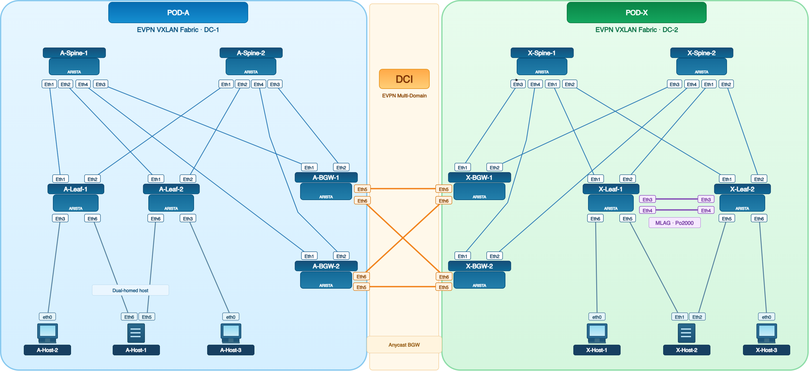
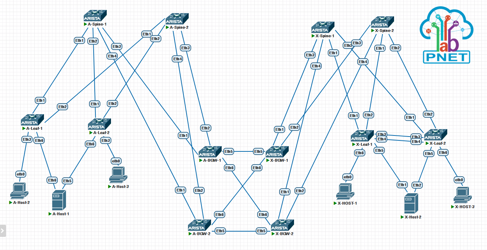

# Построение геораспределенной сетевой фабрики на базе технологии VXLAN BGP EVPN Multi-Site

## 1. Цели

1. Построить два независимых EVPN-домена, POD-A и POD-X, с eBGP Underlay и BGP EVPN Overlay.
2. Организовать VXLAN для L2 service VLAN10 / VNI10010 и VLAN30 / VNI10030, L3 Symmetric IRB 
3. Растянуть между площадками vlan 10 и vlan 30 и не растягивать локальные VLAN20 и VLAN40.
4. В POD-X на Leaf использовать MLAG
5. Использовать для связи между сайтами четыре маршрутизируемых DCI канала **full mesh** и BGW с **Anycast Gateway** с общим VTEP на площадку.
6. Протестировать отказ BGW, отдельных DCI-линков на BGW.

## 2. Схема сети


## 3. IP-план

### 3.1. Разделение POD

| Назначение | POD-A | POD-X |
|---|---|---|
| Underlay | 10.1.0.0/16 | 10.2.0.0/16 |
| Loopback0: Router ID/EVPN | 10.1.0.0/24 | 10.2.0.0/24 |
| Loopback1: VTEP | 10.1.1.0/24 | 10.2.1.0/24 |
| eBGP P2P Spine-1 | 10.1.10.0/24 | 10.2.10.0/24 |
| eBGP P2P Spine-2 | 10.1.20.0/24 | 10.2.20.0/24 |
| MLAG peer subnet | | 10.2.254.0/24 — только X-Leaf |
| DCI | 10.255.0.0/24 | общий пул для 4 P2P |

### 3.2. Underlay — адреса портов Spine

Все адреса назначаются отдельными `/31` point-to-point. На Spine — чётный IP, на Leaf/BGW — нечётный IP того же `/31`.

| Spine | Ethernet1 | Ethernet2 | Ethernet3 | Ethernet4 |
|---|---|---|---|---|
| A-Spine-1 | `10.1.10.0/31` | `10.1.20.0/31` | `10.1.10.2/31` | `10.1.20.2/31` |
| A-Spine-2 | `10.1.20.0/31` | `10.1.20.2/31` | `10.1.20.4/31` | `10.1.20.6/31` |
| X-Spine-1 | `10.2.10.0/31` | `10.2.20.0/31` | `10.2.10.2/31` | `10.2.20.2/31` |
| X-Spine-2 | `10.2.20.0/31` | `10.2.20.2/31` | `10.2.20.4/31` | `10.2.20.6/31` |

### 3.3. Underlay — ответные интерфейсы Leaf и BGW

| Устройство | Ethernet1 → Spine-1 | Ethernet2 → Spine-2 |
|---|---|---|
| A-Leaf-1 | `10.1.10.1/31` | `10.1.20.1/31` |
| A-Leaf-2 | `10.1.20.1/31` | `10.1.20.3/31` |
| A-BGW-1 | `10.1.10.3/31` | `10.1.20.5/31` |
| A-BGW-2 | `10.1.20.3/31` | `10.1.20.7/31` |
| X-Leaf-1 | `10.2.10.1/31` | `10.2.20.1/31` |
| X-Leaf-2 | `10.2.20.1/31` | `10.2.20.3/31` |
| X-BGW-1 | `10.2.10.3/31` | `10.2.20.5/31` |
| X-BGW-2 | `10.2.20.3/31` | `10.2.20.7/31` |

### 3.4. Loopback и ASN

| Устройство | ASN | Loopback0 | VTEP Anycast |
|---|---:|---|---|
| A-Spine-1 | 65001 | 10.1.0.1 | — |
| A-Spine-2 | 65001 | 10.1.0.2 | — | 
| A-Leaf-1 | 65111 | 10.1.0.11 | 10.1.1.11 |
| A-Leaf-2 | 65112 | 10.1.0.12 | 10.1.1.12 |
| A-BGW-1 | 65131 | 10.1.0.21 | 10.1.1.254 |
| A-BGW-2 | 65132 | 10.1.0.22 | 10.1.1.254 |
| X-Spine-1 | 65002 | 10.2.0.1 | — |
| X-Spine-2 | 65002 | 10.2.0.2 | — |
| X-Leaf-1 | 65210 | 10.2.0.11 | 10.2.1.10 |
| X-Leaf-2 | 65210 | 10.2.0.12 | 10.2.1.10 |
| X-BGW-1 | 65231 | 10.2.0.21 | 10.2.1.254 |
| X-BGW-2 | 65232 | 10.2.0.22 | 10.2.1.254 |

## 4. EVPN services

| VLAN | VNI | Сеть | Где | Режим |
|---|---:|---|---|---|
| 10 | 10010 | 172.16.10.0/24 | A + X | Междоменный L2 stretch |
| 20 | 10020 | 172.16.20.0/24 | A | Локальная L2 сеть A |
| 30 | 10030 | 172.16.30.0/24 | A + X | Междоменный L2 stretch |
| 40 | 10040 | 172.16.40.0/24 | X | Локальная L2 сеть X |
| TENANT | 50000 | VRF | A + X | L3 VNI для Symmetric IRB |


### 4.1. Тестовые хосты

| Имя | IP | VLAN | Подключение |
|---|---|---|---|
| A-Host-2 | 172.16.30.200/24 | 30 | A-Leaf-1 Eth3 |
| A-Host-1 | 172.16.10.20/24 | 10 | A-Leaf-1 Eth6 + A-Leaf-2 Eth6 |
| A-Host-3 | 172.16.20.20/24 | 20 | A-Leaf-2 Eth3 |
| X-Host-1 | 172.16.10.100/24 | 30 | X-Leaf-1 Eth6 |
| X-Host-2 | 172.16.30.100/24 | 30 | X-Leaf-1/2 Eth5, **MLAG LACP** |
| X-Host-3 | 172.16.40.40/24 | 30 | X-Leaf-2 Eth6 |

## 5. Стенд.

Стенд собран в PnetLab 5.3.11 

Arista Software image version: 4.33.1.1F



## 6. Конфигурация устройств.

<details>
<summary>A-Spine-1</summary>

```
A-Spine-1#sh run
! Command: show running-config
! device: A-Spine-1 (vEOS-lab, EOS-4.33.1.1F)
!
! boot system flash:/vEOS-lab.swi
!
no aaa root
!
no service interface inactive port-id allocation disabled
!
transceiver qsfp default-mode 4x10G
!
service routing protocols model multi-agent
!
hostname A-Spine-1
!
spanning-tree mode mstp
!
system l1
   unsupported speed action error
   unsupported error-correction action error
!
interface Ethernet1
   mtu 9000
   no switchport
   ip address 10.1.10.0/31
!
interface Ethernet2
   mtu 9000
   no switchport
   ip address 10.1.10.2/31
!
interface Ethernet3
   mtu 9000
   no switchport
   ip address 10.1.10.4/31
!
interface Ethernet4
   mtu 9000
   no switchport
   ip address 10.1.10.6/31
!
interface Ethernet5
!
interface Ethernet6
!
interface Ethernet7
!
interface Ethernet8
!
interface Loopback0
   ip address 10.1.0.1/32
!
interface Management1
!
ip routing
!
router bgp 65001
   router-id 10.1.0.1
   no bgp default ipv4-unicast
   timers bgp 3 9
   maximum-paths 8 ecmp 8
   neighbor EVPN-LOCAL peer group
   neighbor EVPN-LOCAL next-hop-unchanged
   neighbor EVPN-LOCAL update-source Loopback0
   neighbor EVPN-LOCAL ebgp-multihop 5
   neighbor EVPN-LOCAL send-community extended
   neighbor UNDERLAY peer group
   neighbor 10.1.0.11 peer group EVPN-LOCAL
   neighbor 10.1.0.11 remote-as 65111
   neighbor 10.1.0.12 peer group EVPN-LOCAL
   neighbor 10.1.0.12 remote-as 65112
   neighbor 10.1.0.21 peer group EVPN-LOCAL
   neighbor 10.1.0.21 remote-as 65131
   neighbor 10.1.0.22 peer group EVPN-LOCAL
   neighbor 10.1.0.22 remote-as 65132
   neighbor 10.1.10.1 peer group UNDERLAY
   neighbor 10.1.10.1 remote-as 65111
   neighbor 10.1.10.1 description A-LEAF-1
   neighbor 10.1.10.3 peer group UNDERLAY
   neighbor 10.1.10.3 remote-as 65112
   neighbor 10.1.10.3 description A-LEAF-2
   neighbor 10.1.10.5 peer group UNDERLAY
   neighbor 10.1.10.5 remote-as 65131
   neighbor 10.1.10.5 description A-BGW-1
   neighbor 10.1.10.7 peer group UNDERLAY
   neighbor 10.1.10.7 remote-as 65132
   neighbor 10.1.10.7 description A-BGW-2
   !
   address-family evpn
      neighbor EVPN-LOCAL activate
   !
   address-family ipv4
      neighbor UNDERLAY activate
      network 10.1.0.1/32
!
router multicast
   ipv4
      software-forwarding kernel
   !
   ipv6
      software-forwarding kernel
!
end

```

</details>

<details>
<summary>A-Spine-2</summary>

```
A-Spine-2#sh run
! Command: show running-config
! device: A-Spine-2 (vEOS-lab, EOS-4.33.1.1F)
!
! boot system flash:/vEOS-lab.swi
!
no aaa root
!
no service interface inactive port-id allocation disabled
!
transceiver qsfp default-mode 4x10G
!
service routing protocols model multi-agent
!
hostname A-Spine-2
!
spanning-tree mode mstp
!
system l1
   unsupported speed action error
   unsupported error-correction action error
!
interface Ethernet1
   mtu 9000
   no switchport
   ip address 10.1.20.0/31
!
interface Ethernet2
   mtu 9000
   no switchport
   ip address 10.1.20.2/31
!
interface Ethernet3
   mtu 9000
   no switchport
   ip address 10.1.20.4/31
!
interface Ethernet4
   mtu 9000
   no switchport
   ip address 10.1.20.6/31
!
interface Ethernet5
   no switchport
!
interface Ethernet6
!
interface Ethernet7
!
interface Ethernet8
!
interface Loopback0
   ip address 10.1.0.2/32
!
interface Management1
!
ip routing
!
router bgp 65001
   router-id 10.1.0.2
   no bgp default ipv4-unicast
   timers bgp 3 9
   maximum-paths 8 ecmp 8
   neighbor EVPN-LOCAL peer group
   neighbor EVPN-LOCAL next-hop-unchanged
   neighbor EVPN-LOCAL update-source Loopback0
   neighbor EVPN-LOCAL ebgp-multihop 5
   neighbor EVPN-LOCAL send-community extended
   neighbor UNDERLAY peer group
   neighbor 10.1.0.11 peer group EVPN-LOCAL
   neighbor 10.1.0.11 remote-as 65111
   neighbor 10.1.0.12 peer group EVPN-LOCAL
   neighbor 10.1.0.12 remote-as 65112
   neighbor 10.1.0.21 peer group EVPN-LOCAL
   neighbor 10.1.0.21 remote-as 65131
   neighbor 10.1.0.22 peer group EVPN-LOCAL
   neighbor 10.1.0.22 remote-as 65132
   neighbor 10.1.20.1 peer group UNDERLAY
   neighbor 10.1.20.1 remote-as 65111
   neighbor 10.1.20.1 description A-Leaf-1
   neighbor 10.1.20.3 peer group UNDERLAY
   neighbor 10.1.20.3 remote-as 65112
   neighbor 10.1.20.3 description A-Leaf-2
   neighbor 10.1.20.5 peer group UNDERLAY
   neighbor 10.1.20.5 remote-as 65131
   neighbor 10.1.20.5 description A-BGW-1
   neighbor 10.1.20.7 peer group UNDERLAY
   neighbor 10.1.20.7 remote-as 65132
   neighbor 10.1.20.7 description A-BGW-2
   !
   address-family evpn
      neighbor EVPN-LOCAL activate
   !
   address-family ipv4
      neighbor UNDERLAY activate
      network 10.1.0.2/32
!
router multicast
   ipv4
      software-forwarding kernel
   !
   ipv6
      software-forwarding kernel
!
end

```

</details>

<details>
<summary>A-Leaf-1</summary>

```
A-Leaf-1#sh run
! Command: show running-config
! device: A-Leaf-1 (vEOS-lab, EOS-4.33.1.1F)
!
! boot system flash:/vEOS-lab.swi
!
no aaa root
!
no service interface inactive port-id allocation disabled
!
transceiver qsfp default-mode 4x10G
!
service routing protocols model multi-agent
!
hostname A-Leaf-1
!
spanning-tree mode mstp
!
system l1
   unsupported speed action error
   unsupported error-correction action error
!
vlan 10
   name vxlan10010
!
vlan 20
   name vxlan10020
!
vrf instance TENANT
!
interface Port-Channel6
   switchport access vlan 10
   !
   evpn ethernet-segment
      identifier 0000:0000:0000:0000:0010
      route-target import 00:00:00:00:00:10
   lacp system-id 0200.0000.0010
!
interface Ethernet1
   mtu 9000
   no switchport
   ip address 10.1.10.1/31
!
interface Ethernet2
   mtu 9000
   no switchport
   ip address 10.1.20.1/31
!
interface Ethernet3
   switchport access vlan 30
!
interface Ethernet4
!
interface Ethernet5
!
interface Ethernet6
   channel-group 6 mode active
!
interface Ethernet7
   speed 100full
   lacp timer fast
!
interface Ethernet8
   switchport access vlan 10
!
interface Loopback0
   ip address 10.1.0.11/32
!
interface Loopback1
   ip address 10.1.1.11/32
!
interface Management1
!
interface Vlan10
   vrf TENANT
   ip address virtual 172.16.10.254/24
!
interface Vlan20
   vrf TENANT
   ip address virtual 172.16.20.254/24
!
interface Vlan30
   vrf TENANT
   ip address virtual 172.16.30.254/24
!
interface Vxlan1
   vxlan source-interface Loopback1
   vxlan udp-port 4789
   vxlan vlan 10 vni 10010
   vxlan vlan 20 vni 10020
   vxlan vlan 30 vni 10030
   vxlan vrf TENANT vni 50000
!
ip virtual-router mac-address 00:1c:73:00:00:99
!
ip routing
ip routing vrf TENANT
!
ip prefix-list PL-LOOPBACKS
   seq 10 permit 10.1.0.11/32
   seq 20 permit 10.1.1.11/32
!
route-map RM-LOOPBACKS permit 10
   match ip address prefix-list PL-LOOPBACKS
!
router bgp 65111
   router-id 10.1.0.11
   no bgp default ipv4-unicast
   timers bgp 3 9
   maximum-paths 8 ecmp 8
   neighbor EVPN-LOCAL peer group
   neighbor EVPN-LOCAL update-source Loopback0
   neighbor EVPN-LOCAL ebgp-multihop 5
   neighbor EVPN-LOCAL send-community extended
   neighbor UNDERLAY peer group
   neighbor 10.1.0.1 peer group EVPN-LOCAL
   neighbor 10.1.0.1 remote-as 65001
   neighbor 10.1.0.2 peer group EVPN-LOCAL
   neighbor 10.1.0.2 remote-as 65001
   neighbor 10.1.10.0 peer group UNDERLAY
   neighbor 10.1.10.0 remote-as 65001
   neighbor 10.1.20.0 peer group UNDERLAY
   neighbor 10.1.20.0 remote-as 65001
   redistribute connected route-map RM-LOOPBACKS
   !
   vlan 10
      rd 10.1.0.11:10010
      route-target both 65001:10010
      redistribute learned
   !
   vlan 20
      rd 10.1.0.11:10020
      route-target both 65001:10020
      redistribute learned
   !
   vlan 30
      rd 10.1.0.11:10030
      route-target both 65001:10030
      redistribute learned
   !
   address-family evpn
      neighbor EVPN-LOCAL activate
   !
   address-family ipv4
      neighbor UNDERLAY activate
      network 10.1.0.11/32
   !
   vrf TENANT
      rd 10.1.0.11:50000
      route-target import evpn 65000:50000
      route-target export evpn 65000:50000
      router-id 10.1.0.11
      redistribute connected
!
router multicast
   ipv4
      software-forwarding kernel
   !
   ipv6
      software-forwarding kernel
!
end

```

</details>

<details>
<summary>A-Leaf-2</summary>

```
A-Leaf-2(config)#sh run
! Command: show running-config
! device: A-Leaf-2 (vEOS-lab, EOS-4.33.1.1F)
!
! boot system flash:/vEOS-lab.swi
!
no aaa root
!
no service interface inactive port-id allocation disabled
!
transceiver qsfp default-mode 4x10G
!
service routing protocols model multi-agent
!
hostname A-Leaf-2
!
spanning-tree mode mstp
!
system l1
   unsupported speed action error
   unsupported error-correction action error
!
vlan 10
   name vxlan10010
!
vlan 20
   name vxlan10020
!
vlan 30
   name vxlan10030
!
vrf instance TENANT
!
interface Port-Channel5
   switchport access vlan 30
!
interface Port-Channel6
   switchport access vlan 10
   !
   evpn ethernet-segment
      identifier 0000:0000:0000:0000:0010
      route-target import 00:00:00:00:00:10
   lacp system-id 0200.0000.0010
!
interface Port-Channel7
!
interface Ethernet1
   mtu 9000
   no switchport
   ip address 10.1.10.3/31
!
interface Ethernet2
   mtu 9000
   no switchport
   ip address 10.1.20.3/31
!
interface Ethernet3
   switchport access vlan 20
!
interface Ethernet4
!
interface Ethernet5
   channel-group 5 mode active
!
interface Ethernet6
   channel-group 6 mode active
!
interface Ethernet7
   channel-group 7 mode active
   lacp timer fast
!
interface Ethernet8
   switchport access vlan 20
!
interface Loopback0
   ip address 10.1.0.12/32
!
interface Loopback1
   ip address 10.1.1.12/32
!
interface Management1
!
interface Vlan10
   vrf TENANT
   ip address virtual 172.16.10.254/24
!
interface Vlan20
   vrf TENANT
   ip address virtual 172.16.20.254/24
!
interface Vlan30
   vrf TENANT
   ip address virtual 172.16.30.254/24
!
interface Vxlan1
   vxlan source-interface Loopback1
   vxlan udp-port 4789
   vxlan vlan 10 vni 10010
   vxlan vlan 20 vni 10020
   vxlan vlan 30 vni 10030
   vxlan vrf TENANT vni 50000
!
ip virtual-router mac-address 00:1c:73:00:00:99
!
ip routing
ip routing vrf TENANT
!
ip prefix-list PL-LOOPBACKS
   seq 10 permit 10.1.0.12/32
   seq 20 permit 10.1.1.12/32
!
route-map RM-LOOPBACKS permit 10
   match ip address prefix-list PL-LOOPBACKS
!
router bgp 65112
   router-id 10.1.0.12
   no bgp default ipv4-unicast
   timers bgp 3 9
   maximum-paths 8 ecmp 8
   neighbor EVPN-LOCAL peer group
   neighbor EVPN-LOCAL update-source Loopback0
   neighbor EVPN-LOCAL ebgp-multihop 5
   neighbor EVPN-LOCAL send-community extended
   neighbor UNDERLAY peer group
   neighbor 10.1.0.1 peer group EVPN-LOCAL
   neighbor 10.1.0.1 remote-as 65001
   neighbor 10.1.0.2 peer group EVPN-LOCAL
   neighbor 10.1.0.2 remote-as 65001
   neighbor 10.1.10.2 peer group UNDERLAY
   neighbor 10.1.10.2 remote-as 65001
   neighbor 10.1.20.2 peer group UNDERLAY
   neighbor 10.1.20.2 remote-as 65001
   redistribute connected route-map RM-LOOPBACKS
   !
   vlan 10
      rd 10.1.0.12:10010
      route-target both 65001:10010
      redistribute learned
   !
   vlan 20
      rd 10.1.0.12:10020
      route-target both 65001:10020
      redistribute learned
   !
   vlan 30
      rd 10.1.0.12:10030
      route-target both 65001:10030
      redistribute learned
   !
   address-family evpn
      neighbor EVPN-LOCAL activate
   !
   address-family ipv4
      neighbor UNDERLAY activate
      network 10.1.0.12/32
   !
   vrf TENANT
      rd 10.1.0.12:50000
      route-target import evpn 65000:50000
      route-target export evpn 65000:50000
      router-id 10.1.0.12
!
router multicast
   ipv4
      software-forwarding kernel
   !
   ipv6
      software-forwarding kernel
!
end

```

</details>

<details>
<summary>A-BGW-1</summary>

```
A-BGW-1#sh run
! Command: show running-config
! device: A-BGW-1 (vEOS-lab, EOS-4.33.1.1F)
!
! boot system flash:/vEOS-lab.swi
!
no aaa root
!
no service interface inactive port-id allocation disabled
!
transceiver qsfp default-mode 4x10G
!
service routing protocols model multi-agent
!
hostname A-BGW-1
!
spanning-tree mode mstp
!
system l1
   unsupported speed action error
   unsupported error-correction action error
!
vlan 10
   name vxlan10010
!
vlan 20
   name vxlan10020
!
vlan 30
   name vxlan10030
!
vlan 40
   name vxlan10040
!
vrf instance TENANT
!
interface Ethernet1
   mtu 9000
   no switchport
   ip address 10.1.10.5/31
!
interface Ethernet2
   mtu 9000
   no switchport
   ip address 10.1.20.5/31
!
interface Ethernet3
!
interface Ethernet4
!
interface Ethernet5
   mtu 9000
   no switchport
   ip address 10.255.0.0/31
!
interface Ethernet6
   mtu 9000
   no switchport
   ip address 10.255.0.2/31
!
interface Ethernet7
!
interface Ethernet8
!
interface Loopback0
   ip address 10.1.0.21/32
!
interface Loopback1
   description anycast_gateway
   ip address 10.1.1.254/32
!
interface Management1
!
interface Vlan10
   vrf TENANT
   ip address virtual 172.16.10.254/24
!
interface Vlan20
   vrf TENANT
   ip address virtual 172.16.20.254/24
!
interface Vlan30
   vrf TENANT
   ip address virtual 172.16.30.254/24
!
interface Vlan40
   vrf TENANT
   ip address virtual 172.16.40.254/24
!
interface Vxlan1
   vxlan source-interface Loopback1
   vxlan virtual-router encapsulation mac-address 00:1c:73:ab:00:01
   vxlan udp-port 4789
   vxlan vlan 10 vni 10010
   vxlan vlan 20 vni 10020
   vxlan vlan 30 vni 10030
   vxlan vrf TENANT vni 50000
!
ip virtual-router mac-address 00:1c:73:00:00:99
!
ip routing
ip routing vrf TENANT
!
ip prefix-list PL-SELF-LOOPBACKS
   seq 10 permit 10.1.0.21/32
   seq 20 permit 10.1.1.254/32
!
route-map RM-DCI-OUT permit 10
   match ip address prefix-list PL-SELF-LOOPBACKS
!
route-map RM-SELF-LOOPBACKS permit 10
   match ip address prefix-list PL-SELF-LOOPBACKS
!
router bgp 65131
   router-id 10.1.0.21
   no bgp default ipv4-unicast
   timers bgp 3 9
   maximum-paths 8 ecmp 8
   bgp bestpath d-path
   neighbor EVPN-DCI peer group
   neighbor EVPN-DCI update-source Loopback0
   neighbor EVPN-DCI ebgp-multihop 8
   neighbor EVPN-DCI send-community extended
   neighbor EVPN-LOCAL peer group
   neighbor EVPN-LOCAL update-source Loopback0
   neighbor EVPN-LOCAL ebgp-multihop 5
   neighbor EVPN-LOCAL send-community extended
   neighbor UNDERLAY-DCI peer group
   neighbor UNDERLAY-DCI route-map RM-DCI-OUT out
   neighbor UNDERLAY-LOCAL peer group
   neighbor 10.1.0.1 peer group EVPN-LOCAL
   neighbor 10.1.0.1 remote-as 65001
   neighbor 10.1.0.2 peer group EVPN-LOCAL
   neighbor 10.1.0.2 remote-as 65001
   neighbor 10.1.10.4 peer group UNDERLAY-LOCAL
   neighbor 10.1.10.4 remote-as 65001
   neighbor 10.1.10.4 description A-Spine-1
   neighbor 10.1.20.4 peer group UNDERLAY-LOCAL
   neighbor 10.1.20.4 remote-as 65001
   neighbor 10.1.20.4 description A-Spine-2
   neighbor 10.2.0.21 peer group EVPN-DCI
   neighbor 10.2.0.21 remote-as 65231
   no neighbor 10.2.0.21 description
   neighbor 10.2.0.22 peer group EVPN-DCI
   neighbor 10.2.0.22 remote-as 65232
   no neighbor 10.2.0.22 description
   neighbor 10.255.0.1 peer group UNDERLAY-DCI
   neighbor 10.255.0.1 remote-as 65231
   neighbor 10.255.0.1 description X-BGW-1
   neighbor 10.255.0.3 peer group UNDERLAY-DCI
   neighbor 10.255.0.3 remote-as 65232
   neighbor 10.255.0.3 description X-BGW-2
   redistribute connected route-map RM-SELF-LOOPBACKS
   !
   vlan 10
      rd evpn domain all 10.1.0.21:10010
      route-target both 65001:10010
      route-target import evpn domain remote 65000:10010
      route-target export evpn domain remote 65000:10010
      redistribute learned
   !
   vlan 30
      rd evpn domain all 10.1.0.21:10030
      route-target both 65001:10030
      route-target import evpn domain remote 65000:10030
      route-target export evpn domain remote 65000:10030
      redistribute learned
   !
   vlan 40
      rd evpn domain all 10.1.0.21:10040
      route-target both 65001:10040
      route-target import evpn domain remote 65000:10040
      route-target export evpn domain remote 65000:10040
      redistribute learned
   !
   address-family evpn
      neighbor EVPN-DCI activate
      neighbor EVPN-DCI domain remote
      neighbor EVPN-LOCAL activate
      domain identifier 1:1
      domain identifier 9:9 remote
      neighbor default next-hop-self received-evpn-routes route-type ip-prefix inter-domain
   !
   address-family ipv4
      neighbor UNDERLAY-DCI activate
      neighbor UNDERLAY-LOCAL activate
      network 10.1.0.21/32
   !
   vrf TENANT
      rd 10.1.0.21:50000
      route-target import evpn 65000:50000
      route-target export evpn 65000:50000
      router-id 10.1.0.21
      redistribute connected
!
router multicast
   ipv4
      software-forwarding kernel
   !
   ipv6
      software-forwarding kernel
!
end


```

</details>


<details>
<summary>A-BGW-2</summary>

```
A-BGW-2(config)#sh run
! Command: show running-config
! device: A-BGW-2 (vEOS-lab, EOS-4.33.1.1F)
!
! boot system flash:/vEOS-lab.swi
!
no aaa root
!
no service interface inactive port-id allocation disabled
!
transceiver qsfp default-mode 4x10G
!
service routing protocols model multi-agent
!
hostname A-BGW-2
!
spanning-tree mode mstp
!
system l1
   unsupported speed action error
   unsupported error-correction action error
!
vlan 10
   name vxlan10010
!
vlan 20
   name vxlan10020
!
vlan 30
   name vxlan10030
!
vrf instance TENANT
!
interface Ethernet1
   mtu 9000
   no switchport
   ip address 10.1.10.7/31
!
interface Ethernet2
   mtu 9000
   no switchport
   ip address 10.1.20.7/31
!
interface Ethernet3
!
interface Ethernet4
!
interface Ethernet5
   mtu 9000
   no switchport
   ip address 10.255.0.6/31
!
interface Ethernet6
   mtu 9000
   no switchport
   ip address 10.255.0.4/31
!
interface Ethernet7
!
interface Ethernet8
!
interface Loopback0
   ip address 10.1.0.22/32
!
interface Loopback1
   description anycast_gateway
   ip address 10.1.1.254/32
!
interface Management1
!
interface Vlan10
   vrf TENANT
   ip address virtual 172.16.10.254/24
!
interface Vlan30
   vrf TENANT
   ip address virtual 172.16.30.254/24
!
interface Vlan40
   vrf TENANT
   ip address virtual 172.16.40.254/24
!
interface Vxlan1
   vxlan source-interface Loopback1
   vxlan virtual-router encapsulation mac-address 00:1c:73:ab:00:01
   vxlan udp-port 4789
   vxlan vlan 10 vni 10010
   vxlan vlan 30 vni 10030
   vxlan vrf TENANT vni 50000
!
ip virtual-router mac-address 00:1c:73:00:00:99
!
ip routing
ip routing vrf TENANT
!
ip prefix-list PL-SELF-LOOPBACKS
   seq 10 permit 10.1.0.22/32
   seq 20 permit 10.1.1.254/32
!
route-map RM-DCI-OUT permit 10
   match ip address prefix-list PL-SELF-LOOPBACKS
!
route-map RM-SELF-LOOPBACKS permit 10
   match ip address prefix-list PL-SELF-LOOPBACKS
!
router bgp 65132
   router-id 10.1.0.22
   no bgp default ipv4-unicast
   timers bgp 3 9
   maximum-paths 8 ecmp 8
   bgp bestpath d-path
   neighbor EVPN-DCI peer group
   neighbor EVPN-DCI update-source Loopback0
   neighbor EVPN-DCI ebgp-multihop 8
   neighbor EVPN-DCI send-community extended
   neighbor EVPN-LOCAL peer group
   neighbor EVPN-LOCAL update-source Loopback0
   neighbor EVPN-LOCAL ebgp-multihop 5
   neighbor EVPN-LOCAL send-community extended
   neighbor UNDERLAY-DCI peer group
   neighbor UNDERLAY-DCI route-map RM-DCI-OUT out
   neighbor UNDERLAY-LOCAL peer group
   neighbor 10.1.0.1 peer group EVPN-LOCAL
   neighbor 10.1.0.1 remote-as 65001
   neighbor 10.1.0.2 peer group EVPN-LOCAL
   neighbor 10.1.0.2 remote-as 65001
   neighbor 10.1.10.6 peer group UNDERLAY-LOCAL
   neighbor 10.1.10.6 remote-as 65001
   neighbor 10.1.10.6 description A-Spine-1
   neighbor 10.1.20.6 peer group UNDERLAY-LOCAL
   neighbor 10.1.20.6 remote-as 65001
   neighbor 10.1.20.6 description A-Spine-2
   neighbor 10.2.0.21 peer group EVPN-DCI
   neighbor 10.2.0.21 remote-as 65231
   neighbor 10.2.0.22 peer group EVPN-DCI
   neighbor 10.2.0.22 remote-as 65232
   neighbor 10.255.0.5 peer group UNDERLAY-DCI
   neighbor 10.255.0.5 remote-as 65231
   neighbor 10.255.0.5 description X-BGW-1
   neighbor 10.255.0.7 peer group UNDERLAY-DCI
   neighbor 10.255.0.7 remote-as 65232
   neighbor 10.255.0.7 description X-BGW-2
   redistribute connected route-map RM-SELF-LOOPBACKS
   !
   vlan 10
      rd evpn domain all 10.1.0.22:10010
      route-target both 65001:10010
      route-target import evpn domain remote 65000:10010
      route-target export evpn domain remote 65000:10010
      redistribute learned
   !
   vlan 30
      rd evpn domain all 10.1.0.22:10030
      route-target both 65001:10030
      route-target import evpn domain remote 65000:10030
      route-target export evpn domain remote 65000:10030
      redistribute learned
   !
   vlan 40
      rd evpn domain all 10.1.0.22:10040
      route-target both 65001:10040
      route-target import evpn domain remote 65000:10040
      route-target export evpn domain remote 65000:10040
      redistribute learned
   !
   address-family evpn
      neighbor EVPN-DCI activate
      neighbor EVPN-DCI domain remote
      neighbor EVPN-LOCAL activate
      domain identifier 1:1
      domain identifier 9:9 remote
      neighbor default next-hop-self received-evpn-routes route-type ip-prefix inter-domain
   !
   address-family ipv4
      neighbor UNDERLAY-DCI activate
      neighbor UNDERLAY-LOCAL activate
      network 10.1.0.22/32
   !
   vrf TENANT
      rd 10.1.0.22:50000
      route-target import evpn 65000:50000
      route-target export evpn 65000:50000
      redistribute connected
!
router multicast
   ipv4
      software-forwarding kernel
   !
   ipv6
      software-forwarding kernel
!
end

```

</details>


<details>
<summary>X-BGW-1</summary>

```
X-BGW-1#sh run
! Command: show running-config
! device: X-BGW-1 (vEOS-lab, EOS-4.33.1.1F)
!
! boot system flash:/vEOS-lab.swi
!
no aaa root
!
no service interface inactive port-id allocation disabled
!
transceiver qsfp default-mode 4x10G
!
service routing protocols model multi-agent
!
hostname X-BGW-1
!
spanning-tree mode mstp
!
system l1
   unsupported speed action error
   unsupported error-correction action error
!
vlan 10
   name vxlan10010
!
vlan 20
   name vxlan10020
!
vlan 30
   name vxlan10030
!
vrf instance TENANT
!
interface Ethernet1
   mtu 9000
   no switchport
   ip address 10.2.10.5/31
!
interface Ethernet2
   mtu 9000
   no switchport
   ip address 10.2.20.5/31
!
interface Ethernet3
!
interface Ethernet4
!
interface Ethernet5
   mtu 9000
   no switchport
   ip address 10.255.0.1/31
!
interface Ethernet6
   mtu 9000
   no switchport
   ip address 10.255.0.5/31
!
interface Ethernet7
!
interface Ethernet8
!
interface Loopback0
   ip address 10.2.0.21/31
!
interface Loopback1
   description anycast_gateway
   ip address 10.2.1.254/32
!
interface Management1
!
interface Vlan10
   vrf TENANT
   ip address virtual 172.16.10.254/24
!
interface Vlan30
   vrf TENANT
   ip address virtual 172.16.30.254/24
!
interface Vlan40
   vrf TENANT
   ip address virtual 172.16.40.254/24
!
interface Vxlan1
   vxlan source-interface Loopback1
   vxlan virtual-router encapsulation mac-address 00:1c:73:ab:00:02
   vxlan udp-port 4789
   vxlan vlan 10 vni 10010
   vxlan vlan 30 vni 10030
   vxlan vrf TENANT vni 50000
!
ip virtual-router mac-address 00:1c:73:00:00:99
!
ip routing
ip routing vrf TENANT
!
router bgp 65231
   router-id 10.2.0.21
   no bgp default ipv4-unicast
   timers bgp 3 9
   maximum-paths 8 ecmp 8
   bgp bestpath d-path
   neighbor EVPN-DCI peer group
   neighbor EVPN-DCI update-source Loopback0
   neighbor EVPN-DCI ebgp-multihop 8
   neighbor EVPN-DCI send-community extended
   neighbor EVPN-LOCAL peer group
   neighbor EVPN-LOCAL update-source Loopback0
   neighbor EVPN-LOCAL ebgp-multihop 5
   neighbor EVPN-LOCAL send-community extended
   neighbor UNDERLAY-DCI peer group
   neighbor UNDERLAY-LOCAL peer group
   neighbor 10.1.0.21 peer group EVPN-DCI
   neighbor 10.1.0.21 remote-as 65131
   neighbor 10.1.0.22 peer group EVPN-DCI
   neighbor 10.1.0.22 remote-as 65132
   neighbor 10.2.0.1 peer group EVPN-LOCAL
   neighbor 10.2.0.1 remote-as 65002
   neighbor 10.2.0.2 peer group EVPN-LOCAL
   neighbor 10.2.0.2 remote-as 65002
   neighbor 10.2.10.4 peer group UNDERLAY-LOCAL
   neighbor 10.2.10.4 remote-as 65002
   neighbor 10.2.10.4 description X-Spine-1
   neighbor 10.2.20.4 peer group UNDERLAY-LOCAL
   neighbor 10.2.20.4 remote-as 65002
   neighbor 10.2.20.4 description X-Spine-2
   neighbor 10.255.0.0 peer group UNDERLAY-DCI
   neighbor 10.255.0.0 remote-as 65131
   neighbor 10.255.0.0 description A-BGW-1
   neighbor 10.255.0.4 peer group UNDERLAY-DCI
   neighbor 10.255.0.4 remote-as 65132
   neighbor 10.255.0.4 description A-BGW-2
   !
   vlan 10
      rd evpn domain all 10.2.0.21:10010
      route-target both 65002:10010
      route-target import evpn domain remote 65000:10010
      route-target export evpn domain remote 65000:10010
      redistribute learned
   !
   vlan 30
      rd evpn domain all 10.2.0.21:10030
      route-target both 65002:10030
      route-target import evpn domain remote 65000:10030
      route-target export evpn domain remote 65000:10030
      redistribute learned
   !
   vlan 40
      rd evpn domain all 10.2.0.21:10040
      route-target both 65002:10040
      route-target import evpn domain remote 65000:10040
      route-target export evpn domain remote 65000:10040
      redistribute learned
   !
   address-family evpn
      neighbor EVPN-DCI activate
      neighbor EVPN-DCI domain remote
      neighbor EVPN-LOCAL activate
      domain identifier 2:2
      domain identifier 9:9 remote
      neighbor default next-hop-self received-evpn-routes route-type ip-prefix inter-domain
   !
   address-family ipv4
      neighbor UNDERLAY-DCI activate
      neighbor UNDERLAY-LOCAL activate
      network 10.2.0.20/31
   !
   vrf TENANT
      rd 10.2.0.21:50000
      route-target import evpn 65000:50000
      route-target export evpn 65000:50000
      redistribute connected
!
router multicast
   ipv4
      software-forwarding kernel
   !
   ipv6
      software-forwarding kernel
!
end

```

</details>


<details>
<summary>X-BGW-2</summary>

```
X-BGW-2#sh run
! Command: show running-config
! device: X-BGW-2 (vEOS-lab, EOS-4.33.1.1F)
!
! boot system flash:/vEOS-lab.swi
!
no aaa root
!
no service interface inactive port-id allocation disabled
!
transceiver qsfp default-mode 4x10G
!
service routing protocols model multi-agent
!
hostname X-BGW-2
!
spanning-tree mode mstp
!
system l1
   unsupported speed action error
   unsupported error-correction action error
!
vlan 10
   name vxlan10010
!
vlan 20
   name vxlan10020
!
vlan 30
   name vxlan10030
!
vrf instance TENANT
!
interface Ethernet1
   mtu 9000
   no switchport
   ip address 10.2.10.7/31
!
interface Ethernet2
   mtu 9000
   no switchport
   ip address 10.2.20.7/31
!
interface Ethernet3
!
interface Ethernet4
!
interface Ethernet5
   mtu 9000
   no switchport
   ip address 10.255.0.7/31
!
interface Ethernet6
   mtu 9000
   no switchport
   ip address 10.255.0.3/31
!
interface Ethernet7
!
interface Ethernet8
!
interface Loopback0
   ip address 10.2.0.22/32
!
interface Loopback1
   description anycast_gateway
   ip address 10.2.1.254/32
!
interface Management1
!
interface Vlan10
   ip address virtual 172.16.10.254/24
!
interface Vlan30
   vrf TENANT
   ip address virtual 172.16.30.254/24
!
interface Vlan40
   vrf TENANT
   ip address virtual 172.16.40.254/24
!
interface Vxlan1
   vxlan source-interface Loopback1
   vxlan virtual-router encapsulation mac-address 00:1c:73:ab:00:02
   vxlan udp-port 4789
   vxlan vlan 10 vni 10010
   vxlan vlan 30 vni 10030
   vxlan vrf TENANT vni 50000
!
ip virtual-router mac-address 00:1c:73:00:00:99
!
ip routing
ip routing vrf TENANT
!
ip prefix-list PL-SELF-LOOPBACKS
   seq 10 permit 10.2.0.22/32
   seq 20 permit 10.2.1.254/32
!
route-map RM-DCI-OUT permit 10
   match ip address prefix-list PL-SELF-LOOPBACKS
!
route-map RM-SELF-LOOPBACKS permit 10
   match ip address prefix-list PL-SELF-LOOPBACKS
!
router bgp 65232
   router-id 10.2.0.22
   no bgp default ipv4-unicast
   timers bgp 3 9
   maximum-paths 8 ecmp 8
   bgp bestpath d-path
   neighbor EVPN-DCI peer group
   neighbor EVPN-DCI update-source Loopback0
   neighbor EVPN-DCI ebgp-multihop 8
   neighbor EVPN-DCI send-community extended
   neighbor EVPN-LOCAL peer group
   neighbor EVPN-LOCAL update-source Loopback0
   neighbor EVPN-LOCAL ebgp-multihop 5
   neighbor EVPN-LOCAL send-community extended
   neighbor UNDERLAY-DCI peer group
   neighbor UNDERLAY-DCI route-map RM-DCI-OUT out
   neighbor UNDERLAY-LOCAL peer group
   neighbor 10.1.0.21 peer group EVPN-DCI
   neighbor 10.1.0.21 remote-as 65131
   neighbor 10.1.0.22 peer group EVPN-DCI
   neighbor 10.1.0.22 remote-as 65132
   neighbor 10.2.0.1 peer group EVPN-LOCAL
   neighbor 10.2.0.1 remote-as 65002
   neighbor 10.2.0.2 peer group EVPN-LOCAL
   neighbor 10.2.0.2 remote-as 65002
   neighbor 10.2.10.6 peer group UNDERLAY-LOCAL
   neighbor 10.2.10.6 remote-as 65002
   neighbor 10.2.20.6 peer group UNDERLAY-LOCAL
   neighbor 10.2.20.6 remote-as 65002
   neighbor 10.255.0.2 peer group UNDERLAY-DCI
   neighbor 10.255.0.2 remote-as 65131
   neighbor 10.255.0.6 peer group UNDERLAY-DCI
   neighbor 10.255.0.6 remote-as 65132
   redistribute connected route-map RM-SELF-LOOPBACKS
   !
   vlan 10
      rd evpn domain all 10.2.0.22:10010
      route-target both 65002:10010
      route-target import evpn domain remote 65000:10010
      route-target export evpn domain remote 65000:10010
      redistribute learned
   !
   vlan 30
      rd evpn domain all 10.2.0.22:10030
      route-target both 65002:10030
      route-target import evpn domain remote 65000:10030
      route-target export evpn domain remote 65000:10030
      redistribute learned
   !
   vlan 40
      rd evpn domain all 10.2.0.22:10040
      route-target both 65002:10040
      route-target import evpn domain remote 65000:10040
      route-target export evpn domain remote 65000:10040
      redistribute learned
   !
   address-family evpn
      neighbor EVPN-DCI activate
      neighbor EVPN-DCI domain remote
      neighbor EVPN-LOCAL activate
      domain identifier 2:2
      domain identifier 9:9 remote
      neighbor default next-hop-self received-evpn-routes route-type ip-prefix inter-domain
   !
   address-family ipv4
      neighbor UNDERLAY-DCI activate
      neighbor UNDERLAY-LOCAL activate
   !
   vrf TENANT
      rd 10.2.0.22:50000
      route-target import evpn 65000:50000
      route-target export evpn 65000:50000
      router-id 10.2.0.22
      redistribute connected
!
router multicast
   ipv4
      software-forwarding kernel
   !
   ipv6
      software-forwarding kernel
!
end

```

</details>

<details>
<summary>X-Spine-1</summary>

```
X-Spine-1#sh run
! Command: show running-config
! device: X-Spine-1 (vEOS-lab, EOS-4.33.1.1F)
!
! boot system flash:/vEOS-lab.swi
!
no aaa root
!
no service interface inactive port-id allocation disabled
!
transceiver qsfp default-mode 4x10G
!
service routing protocols model multi-agent
!
hostname X-Spine-1
!
spanning-tree mode mstp
!
system l1
   unsupported speed action error
   unsupported error-correction action error
!
interface Ethernet1
   mtu 9000
   no switchport
   ip address 10.2.10.0/31
!
interface Ethernet2
   mtu 9000
   no switchport
   ip address 10.2.10.2/31
!
interface Ethernet3
   mtu 9000
   no switchport
   ip address 10.2.10.4/31
!
interface Ethernet4
   mtu 9000
   no switchport
   ip address 10.2.10.6/31
!
interface Ethernet5
!
interface Ethernet6
!
interface Ethernet7
!
interface Ethernet8
!
interface Loopback0
   ip address 10.2.0.1/32
!
interface Loopback1
   ip address 10.2.1.1/32
!
interface Management1
!
ip routing
!
router bgp 65002
   router-id 10.2.0.1
   no bgp default ipv4-unicast
   maximum-paths 8 ecmp 8
   neighbor EVPN-LOCAL peer group
   neighbor EVPN-LOCAL next-hop-unchanged
   neighbor EVPN-LOCAL update-source Loopback0
   neighbor EVPN-LOCAL ebgp-multihop 5
   neighbor EVPN-LOCAL send-community extended
   neighbor UNDERLAY peer group
   neighbor 10.2.0.11 peer group EVPN-LOCAL
   neighbor 10.2.0.11 remote-as 65210
   neighbor 10.2.0.11 description X-LEAF-1
   neighbor 10.2.0.12 peer group EVPN-LOCAL
   neighbor 10.2.0.12 remote-as 65210
   neighbor 10.2.0.12 description X-LEAF-2
   neighbor 10.2.0.21 peer group EVPN-LOCAL
   neighbor 10.2.0.21 remote-as 65231
   neighbor 10.2.0.21 description X-BGW-1
   neighbor 10.2.0.22 peer group EVPN-LOCAL
   neighbor 10.2.0.22 remote-as 65232
   neighbor 10.2.0.22 description X-BGW-2
   neighbor 10.2.10.1 peer group UNDERLAY
   neighbor 10.2.10.1 remote-as 65210
   neighbor 10.2.10.1 description X-LEAF-1
   neighbor 10.2.10.3 peer group UNDERLAY
   neighbor 10.2.10.3 remote-as 65210
   neighbor 10.2.10.3 description X-LEAF-2
   neighbor 10.2.10.5 peer group UNDERLAY
   neighbor 10.2.10.5 remote-as 65231
   neighbor 10.2.10.5 description X-BGW-1
   neighbor 10.2.10.7 peer group UNDERLAY
   neighbor 10.2.10.7 remote-as 65232
   neighbor 10.2.10.7 description X-BGW-2
   !
   address-family evpn
      neighbor EVPN-LOCAL activate
   !
   address-family ipv4
      neighbor UNDERLAY activate
      network 10.2.0.1/32
!
router multicast
   ipv4
      software-forwarding kernel
   !
   ipv6
      software-forwarding kernel
!
end

```

</details>

<details>
<summary>X-Spine-2</summary>

```
X-Spine-2#sh run
! Command: show running-config
 ! device: X-Spine-2 (vEOS-lab, EOS-4.33.1.1F)
!
! boot system flash:/vEOS-lab.swi
!
no aaa root
!
no service interface inactive port-id allocation disabled
!
transceiver qsfp default-mode 4x10G
!
service routing protocols model multi-agent
!
hostname X-Spine-2
!
spanning-tree mode mstp
!
system l1
   unsupported speed action error
   unsupported error-correction action error
!
interface Ethernet1
   mtu 9000
   no switchport
   ip address 10.2.20.0/31
!
interface Ethernet2
   mtu 9000
   no switchport
   ip address 10.2.20.2/31
!
interface Ethernet3
   mtu 9000
   no switchport
   ip address 10.2.20.4/31
!
interface Ethernet4
   mtu 9000
   no switchport
   ip address 10.2.20.6/31
!
interface Ethernet5
!
interface Ethernet6
!
interface Ethernet7
!
interface Ethernet8
!
interface Loopback0
   ip address 10.2.0.2/32
!
interface Loopback1
   ip address 10.2.1.2/32
!
interface Management1
!
ip routing
!
router bgp 65002
   router-id 10.2.0.2
   no bgp default ipv4-unicast
   maximum-paths 8 ecmp 8
   neighbor EVPN-LOCAL peer group
   neighbor EVPN-LOCAL next-hop-unchanged
   neighbor EVPN-LOCAL update-source Loopback0
   neighbor EVPN-LOCAL ebgp-multihop 5
   neighbor EVPN-LOCAL send-community extended
   neighbor UNDERLAY peer group
   neighbor 10.2.0.11 peer group EVPN-LOCAL
   neighbor 10.2.0.11 remote-as 65210
   neighbor 10.2.0.11 description X-Leaf-1
   neighbor 10.2.0.12 peer group EVPN-LOCAL
   neighbor 10.2.0.12 remote-as 65210
   neighbor 10.2.0.12 description X-Leaf-2
   neighbor 10.2.0.21 peer group EVPN-LOCAL
   neighbor 10.2.0.21 remote-as 65231
   neighbor 10.2.0.21 description X-BGW-1
   neighbor 10.2.0.22 peer group EVPN-LOCAL
   neighbor 10.2.0.22 remote-as 65232
   neighbor 10.2.0.22 description X-BGW-2
   neighbor 10.2.20.1 peer group UNDERLAY
   neighbor 10.2.20.1 remote-as 65210
   neighbor 10.2.20.1 description X-Leaf-1
   neighbor 10.2.20.3 peer group UNDERLAY
   neighbor 10.2.20.3 remote-as 65210
   neighbor 10.2.20.3 description X-Leaf-2
   neighbor 10.2.20.5 peer group UNDERLAY
   neighbor 10.2.20.5 remote-as 65231
   neighbor 10.2.20.5 description X-BGW-1
   neighbor 10.2.20.7 peer group UNDERLAY
   neighbor 10.2.20.7 remote-as 65232
   neighbor 10.2.20.7 description X-BGW-2
   !
   address-family evpn
      neighbor EVPN-LOCAL activate
   !
   address-family ipv4
      neighbor UNDERLAY activate
      network 10.2.0.2/32
!
router multicast
   ipv4
      software-forwarding kernel
   !
   ipv6
      software-forwarding kernel
!
end

```

</details>

<details>
<summary>X-Leaf-1</summary>

```
X-Leaf-1#sh run
! Command: show running-config
! device: X-Leaf-1 (vEOS-lab, EOS-4.33.1.1F)
!
! boot system flash:/vEOS-lab.swi
!
no aaa root
!
no service interface inactive port-id allocation disabled
!
transceiver qsfp default-mode 4x10G
!
service routing protocols model multi-agent
!
hostname X-Leaf-1
!
spanning-tree mode mstp
no spanning-tree vlan-id 4093-4094
!
system l1
   unsupported speed action error
   unsupported error-correction action error
!
vlan 10,30,40
!
vlan 4093
   name MLAG_L3_PEER
   trunk group MLAG_L3
!
vlan 4094
   name MLAG_CONTROL
   trunk group MLAG
!
vrf instance TENANT
!
interface Port-Channel5
   switchport access vlan 30
   mlag 5
!
interface Port-Channel2000
   description MLAG_PEER_LINK
   mtu 9000
   switchport mode trunk
   switchport trunk group MLAG
   switchport trunk group MLAG_L3
!
interface Ethernet1
   no switchport
   ip address 10.2.10.1/31
!
interface Ethernet2
   no switchport
   ip address 10.2.20.1/31
!
interface Ethernet3
   description MLAG_PEERLINK
   mtu 9000
   channel-group 2000 mode active
!
interface Ethernet4
   description MLAG_PEERLINK
   mtu 9000
   channel-group 2000 mode active
!
interface Ethernet5
   channel-group 5 mode active
!
interface Ethernet6
   switchport access vlan 10
!
interface Ethernet7
!
interface Ethernet8
!
interface Loopback0
   ip address 10.2.0.11/32
!
interface Loopback1
   ip address 10.2.1.10/32
!
interface Management1
!
interface Vlan10
   vrf TENANT
   ip address virtual 172.16.10.254/24
!
interface Vlan30
   vrf TENANT
   ip address virtual 172.16.30.254/24
!
interface Vlan40
   vrf TENANT
   ip address virtual 172.16.40.254/24
!
interface Vlan4093
   description BGP_IBGP_OVER_MLAG_PEER
   mtu 9214
   no autostate
   ip address 10.2.254.13/30
!
interface Vlan4094
   description MLAG_PEER_CONTROL
   no autostate
   ip address 10.2.254.9/30
!
interface Vxlan1
   vxlan source-interface Loopback1
   vxlan virtual-router encapsulation mac-address mlag-system-id
   vxlan udp-port 4789
   vxlan vlan 10 vni 10010
   vxlan vlan 30 vni 10030
   vxlan vrf TENANT vni 50000
!
ip virtual-router mac-address 00:1c:73:00:00:99
!
ip routing
ip routing vrf TENANT
!
ip prefix-list PL-LOOPBACKS
   seq 10 permit 10.2.0.11/32
   seq 20 permit 10.2.1.10/32
!
mlag configuration
   domain-id X-LEAF
   local-interface Vlan4094
   peer-address 10.2.254.10
   peer-link Port-Channel2000
!
route-map RM-LOOPBACKS permit 10
   match ip address prefix-list PL-LOOPBACKS
!
router bgp 65210
   router-id 10.2.0.11
   no bgp default ipv4-unicast
   maximum-paths 8 ecmp 8
   neighbor EVPN-LOCAL peer group
   neighbor EVPN-LOCAL update-source Loopback0
   neighbor EVPN-LOCAL ebgp-multihop 5
   neighbor EVPN-LOCAL send-community extended
   neighbor UNDERLAY peer group
   neighbor 10.2.0.1 peer group EVPN-LOCAL
   neighbor 10.2.0.1 remote-as 65002
   neighbor 10.2.0.2 peer group EVPN-LOCAL
   neighbor 10.2.0.2 remote-as 65002
   neighbor 10.2.10.0 peer group UNDERLAY
   neighbor 10.2.10.0 remote-as 65002
   neighbor 10.2.10.0 description X-Spine-1
   neighbor 10.2.20.0 peer group UNDERLAY
   neighbor 10.2.20.0 remote-as 65002
   neighbor 10.2.20.0 description X-Spine-2
   neighbor 10.2.254.14 remote-as 65210
   neighbor 10.2.254.14 next-hop-self
   redistribute connected route-map RM-LOOPBACKS
   !
   vlan 10
      rd 10.2.0.11:10010
      route-target both 65002:10010
      redistribute learned
   !
   vlan 30
      rd 10.2.0.11:10030
      route-target both 65002:10030
      redistribute learned
   !
   vlan 40
      rd 10.2.0.11:10040
      route-target both 65002:10040
      redistribute learned
   !
   address-family evpn
      neighbor EVPN-LOCAL activate
   !
   address-family ipv4
      neighbor UNDERLAY activate
      neighbor 10.2.254.14 activate
      network 10.2.0.11/32
   !
   vrf TENANT
      rd 10.2.0.11:50000
      route-target import evpn 65000:50000
      route-target export evpn 65000:50000
      redistribute connected
!
router multicast
   ipv4
      software-forwarding kernel
   !
   ipv6
      software-forwarding kernel
!
end

```

</details>

<details>
<summary>X-Leaf-2</summary>

```
X-Leaf-2#sh run
! Command: show running-config
! device: X-Leaf-2 (vEOS-lab, EOS-4.33.1.1F)
!
! boot system flash:/vEOS-lab.swi
!
no aaa root
!
no service interface inactive port-id allocation disabled
!
transceiver qsfp default-mode 4x10G
!
service routing protocols model multi-agent
!
hostname X-Leaf-2
!
spanning-tree mode mstp
no spanning-tree vlan-id 4093-4094
!
system l1
   unsupported speed action error
   unsupported error-correction action error
!
vlan 10,30,40
!
vlan 4093
   name MLAG_L3_PEER
   trunk group MLAG_L3
!
vlan 4094
   name MLAG_CONTROL
   trunk group MLAG
!
vrf instance TENANT
!
interface Port-Channel5
   switchport access vlan 30
   mlag 5
!
interface Port-Channel2000
   description MLAG_PEER_LINK
   mtu 9000
   switchport mode trunk
   switchport trunk group MLAG
   switchport trunk group MLAG_L3
!
interface Ethernet1
   mtu 9000
   no switchport
   ip address 10.2.10.3/31
!
interface Ethernet2
   mtu 9000
   no switchport
   ip address 10.2.20.3/31
!
interface Ethernet3
   mtu 9000
   channel-group 2000 mode active
!
interface Ethernet4
   mtu 9000
   channel-group 2000 mode active
!
interface Ethernet5
   channel-group 5 mode active
!
interface Ethernet6
   switchport access vlan 40
!
interface Ethernet7
!
interface Ethernet8
!
interface Loopback0
   ip address 10.2.0.12/32
!
interface Loopback1
   ip address 10.2.1.12/32
!
interface Management1
!
interface Vlan10
   vrf TENANT
   ip address virtual 172.16.10.254/24
!
interface Vlan30
   vrf TENANT
   ip address virtual 172.16.30.254/24
!
interface Vlan40
   vrf TENANT
   ip address virtual 172.16.40.254/24
!
interface Vlan4093
   description BGP_IBGP_OVER_MLAG_PEER
   mtu 9214
   no autostate
   ip address 10.2.254.14/30
!
interface Vlan4094
   description MLAG_PEER_CONTROL
   no autostate
   ip address 10.2.254.10/30
!
interface Vxlan1
   vxlan source-interface Loopback1
   vxlan virtual-router encapsulation mac-address mlag-system-id
   vxlan udp-port 4789
   vxlan vlan 10 vni 10010
   vxlan vlan 30 vni 10030
   vxlan vrf TENANT vni 50000
!
ip virtual-router mac-address 00:1c:73:00:00:99
!
ip routing
ip routing vrf TENANT
!
ip prefix-list PL-LOOPBACKS
   seq 10 permit 10.2.0.12/32
   seq 20 permit 10.2.1.10/32
!
ip prefix-list PL-SITE-LOCAL-30
   seq 10 permit 172.16.30.0/24
!
mlag configuration
   domain-id X-LEAF
   local-interface Vlan4094
   peer-address 10.2.254.9
   peer-link Port-Channel2000
!
route-map RM-LOOPBACKS permit 10
   match ip address prefix-list PL-LOOPBACKS
!
route-map RM-SITE-LOCAL-30 permit 10
   match ip address prefix-list PL-SITE-LOCAL-30
!
router bgp 65210
   router-id 10.2.0.12
   no bgp default ipv4-unicast
   maximum-paths 8 ecmp 8
   neighbor EVPN-LOCAL peer group
   neighbor EVPN-LOCAL update-source Loopback0
   neighbor EVPN-LOCAL ebgp-multihop 5
   neighbor EVPN-LOCAL send-community extended
   neighbor UNDERLAY peer group
   neighbor 10.2.0.1 peer group EVPN-LOCAL
   neighbor 10.2.0.1 remote-as 65002
   neighbor 10.2.0.2 peer group EVPN-LOCAL
   neighbor 10.2.0.2 remote-as 65002
   neighbor 10.2.10.2 peer group UNDERLAY
   neighbor 10.2.10.2 remote-as 65002
   neighbor 10.2.10.2 description X-Spine-1
   neighbor 10.2.20.2 peer group UNDERLAY
   neighbor 10.2.20.2 remote-as 65002
   neighbor 10.2.20.2 description X-Spine-2
   neighbor 10.2.254.13 remote-as 65210
   neighbor 10.2.254.13 next-hop-self
   redistribute connected route-map RM-LOOPBACKS
   !
   vlan 10
      rd 10.2.0.12:10010
      route-target both 65002:10010
      redistribute learned
   !
   vlan 30
      rd 10.2.0.12:10030
      route-target both 65002:10030
      redistribute learned
   !
   vlan 40
      rd 10.2.0.11:10040
      route-target both 65002:10040
      redistribute learned
   !
   vlan 4093
   !
   vlan 4094
   !
   address-family evpn
      neighbor EVPN-LOCAL activate
   !
   address-family ipv4
      neighbor UNDERLAY activate
      neighbor 10.2.254.13 activate
      network 10.2.0.12/32
   !
   vrf TENANT
      rd 10.2.0.12:50000
      route-target import evpn 65000:50000
      route-target export evpn 65000:50000
      redistribute connected
!
router multicast
   ipv4
      software-forwarding kernel
   !
   ipv6
      software-forwarding kernel
!
end

```

</details>

## 6. Проверки 

Проверям bgp соседство для A-Leaf-1

```
A-Leaf-1#sh bgp summary
BGP summary information for VRF default
Router identifier 10.1.0.11, local AS number 65111
Neighbor           AS Session State AFI/SAFI                AFI/SAFI State   NLRI Rcd   NLRI Acc
--------- ----------- ------------- ----------------------- -------------- ---------- ----------
10.1.0.1        65001 Established   L2VPN EVPN              Negotiated             25         25
10.1.0.2        65001 Established   L2VPN EVPN              Negotiated             25         25
10.1.10.0       65001 Established   IPv4 Unicast            Negotiated             14         14
10.1.20.0       65001 Established   IPv4 Unicast            Negotiated             14         14
```
Проверяем маршрут до BGW
```
A-Leaf-1#show ip route 10.1.1.254

VRF: default
Source Codes:
       C - connected, S - static, K - kernel,
       O - OSPF, IA - OSPF inter area, E1 - OSPF external type 1,
       E2 - OSPF external type 2, N1 - OSPF NSSA external type 1,
       N2 - OSPF NSSA external type2, B - Other BGP Routes,
       B I - iBGP, B E - eBGP, R - RIP, I L1 - IS-IS level 1,
       I L2 - IS-IS level 2, O3 - OSPFv3, A B - BGP Aggregate,
       A O - OSPF Summary, NG - Nexthop Group Static Route,
       V - VXLAN Control Service, M - Martian,
       DH - DHCP client installed default route,
       DP - Dynamic Policy Route, L - VRF Leaked,
       G  - gRIBI, RC - Route Cache Route,
       CL - CBF Leaked Route

 B E      10.1.1.254/32 [200/0]
           via 10.1.10.0, Ethernet1
           via 10.1.20.0, Ethernet2
```

<details>

<summary>Проверяем route Type3</summary>

```
A-Leaf-1#show bgp evpn route-type imet
BGP routing table information for VRF default
Router identifier 10.1.0.11, local AS number 65111
Route status codes: * - valid, > - active, S - Stale, E - ECMP head, e - ECMP
                    c - Contributing to ECMP, % - Pending best path selection
Origin codes: i - IGP, e - EGP, ? - incomplete
AS Path Attributes: Or-ID - Originator ID, C-LST - Cluster List, LL Nexthop - Link Local Nexthop

          Network                Next Hop              Metric  LocPref Weight  Path
 * >      RD: 10.1.0.11:10010 imet 10.1.1.11
                                 -                     -       -       0       i
 * >      RD: 10.1.0.11:10020 imet 10.1.1.11
                                 -                     -       -       0       i
 * >      RD: 10.1.0.11:10030 imet 10.1.1.11
                                 -                     -       -       0       i
 * >Ec    RD: 10.1.0.12:10010 imet 10.1.1.12
                                 10.1.1.12             -       100     0       65001 65112 i
 *  ec    RD: 10.1.0.12:10010 imet 10.1.1.12
                                 10.1.1.12             -       100     0       65001 65112 i
 * >Ec    RD: 10.1.0.12:10020 imet 10.1.1.12
                                 10.1.1.12             -       100     0       65001 65112 i
 *  ec    RD: 10.1.0.12:10020 imet 10.1.1.12
                                 10.1.1.12             -       100     0       65001 65112 i
 * >Ec    RD: 10.1.0.12:10030 imet 10.1.1.12
                                 10.1.1.12             -       100     0       65001 65112 i
 *  ec    RD: 10.1.0.12:10030 imet 10.1.1.12
                                 10.1.1.12             -       100     0       65001 65112 i
 * >Ec    RD: 10.1.0.21:10010 imet 10.1.1.254
                                 10.1.1.254            -       100     0       65001 65131 i
 *  ec    RD: 10.1.0.21:10010 imet 10.1.1.254
                                 10.1.1.254            -       100     0       65001 65131 i
 * >Ec    RD: 10.1.0.21:10030 imet 10.1.1.254
                                 10.1.1.254            -       100     0       65001 65131 i
 *  ec    RD: 10.1.0.21:10030 imet 10.1.1.254
                                 10.1.1.254            -       100     0       65001 65131 i
 * >Ec    RD: 10.1.0.22:10010 imet 10.1.1.254
                                 10.1.1.254            -       100     0       65001 65132 i
 *  ec    RD: 10.1.0.22:10010 imet 10.1.1.254
                                 10.1.1.254            -       100     0       65001 65132 i
 * >Ec    RD: 10.1.0.22:10030 imet 10.1.1.254
                                 10.1.1.254            -       100     0       65001 65132 i
 *  ec    RD: 10.1.0.22:10030 imet 10.1.1.254
                                 10.1.1.254            -       100     0       65001 65132 i
```


</details>

<details>

<summary>Проверяем route Type5</summary>

```
A-Leaf-1#show bgp evpn route-type ip-prefix ipv4
BGP routing table information for VRF default
Router identifier 10.1.0.11, local AS number 65111
Route status codes: * - valid, > - active, S - Stale, E - ECMP head, e - ECMP
                    c - Contributing to ECMP, % - Pending best path selection
Origin codes: i - IGP, e - EGP, ? - incomplete
AS Path Attributes: Or-ID - Originator ID, C-LST - Cluster List, LL Nexthop - Link Local Nexthop

          Network                Next Hop              Metric  LocPref Weight  Path
 * >      RD: 10.1.0.11:50000 ip-prefix 172.16.10.0/24
                                 -                     -       -       0       i
 * >Ec    RD: 10.1.0.12:50000 ip-prefix 172.16.10.0/24
                                 10.1.1.12             -       100     0       65001 65112 i
 *  ec    RD: 10.1.0.12:50000 ip-prefix 172.16.10.0/24
                                 10.1.1.12             -       100     0       65001 65112 i
 * >Ec    RD: 10.1.0.21:50000 ip-prefix 172.16.10.0/24
                                 10.1.1.254            -       100     0       65001 65131 i
 *  ec    RD: 10.1.0.21:50000 ip-prefix 172.16.10.0/24
                                 10.1.1.254            -       100     0       65001 65131 i
 * >Ec    RD: 10.1.0.22:50000 ip-prefix 172.16.10.0/24
                                 10.1.1.254            -       100     0       65001 65132 i
 *  ec    RD: 10.1.0.22:50000 ip-prefix 172.16.10.0/24
                                 10.1.1.254            -       100     0       65001 65132 i
 * >Ec    RD: 10.2.0.11:50000 ip-prefix 172.16.10.0/24
                                 10.1.1.254            -       100     0       65001 65131 65231 65002 65210 i
 *  ec    RD: 10.2.0.11:50000 ip-prefix 172.16.10.0/24
                                 10.1.1.254            -       100     0       65001 65131 65231 65002 65210 i
 * >Ec    RD: 10.2.0.21:50000 ip-prefix 172.16.10.0/24
                                 10.1.1.254            -       100     0       65001 65131 65231 i
 *  ec    RD: 10.2.0.21:50000 ip-prefix 172.16.10.0/24
                                 10.1.1.254            -       100     0       65001 65131 65231 i
 * >      RD: 10.1.0.11:50000 ip-prefix 172.16.20.0/24
                                 -                     -       -       0       i
 * >Ec    RD: 10.1.0.12:50000 ip-prefix 172.16.20.0/24
                                 10.1.1.12             -       100     0       65001 65112 i
 *  ec    RD: 10.1.0.12:50000 ip-prefix 172.16.20.0/24
                                 10.1.1.12             -       100     0       65001 65112 i
 * >Ec    RD: 10.1.0.21:50000 ip-prefix 172.16.20.0/24
                                 10.1.1.254            -       100     0       65001 65131 i
 *  ec    RD: 10.1.0.21:50000 ip-prefix 172.16.20.0/24
                                 10.1.1.254            -       100     0       65001 65131 i
 * >      RD: 10.1.0.11:50000 ip-prefix 172.16.30.0/24
                                 -                     -       -       0       i
 * >Ec    RD: 10.1.0.12:50000 ip-prefix 172.16.30.0/24
                                 10.1.1.12             -       100     0       65001 65112 i
 *  ec    RD: 10.1.0.12:50000 ip-prefix 172.16.30.0/24
                                 10.1.1.12             -       100     0       65001 65112 i
 * >Ec    RD: 10.1.0.21:50000 ip-prefix 172.16.30.0/24
                                 10.1.1.254            -       100     0       65001 65131 i
 *  ec    RD: 10.1.0.21:50000 ip-prefix 172.16.30.0/24
                                 10.1.1.254            -       100     0       65001 65131 i
 * >Ec    RD: 10.1.0.22:50000 ip-prefix 172.16.30.0/24
                                 10.1.1.254            -       100     0       65001 65132 i
 *  ec    RD: 10.1.0.22:50000 ip-prefix 172.16.30.0/24
                                 10.1.1.254            -       100     0       65001 65132 i
 * >Ec    RD: 10.2.0.11:50000 ip-prefix 172.16.30.0/24
                                 10.1.1.254            -       100     0       65001 65131 65231 65002 65210 i
 *  ec    RD: 10.2.0.11:50000 ip-prefix 172.16.30.0/24
                                 10.1.1.254            -       100     0       65001 65131 65231 65002 65210 i
 * >Ec    RD: 10.2.0.21:50000 ip-prefix 172.16.30.0/24
                                 10.1.1.254            -       100     0       65001 65131 65231 i
 *  ec    RD: 10.2.0.21:50000 ip-prefix 172.16.30.0/24
                                 10.1.1.254            -       100     0       65001 65131 65231 i
 * >Ec    RD: 10.2.0.22:50000 ip-prefix 172.16.30.0/24
                                 10.1.1.254            -       100     0       65001 65131 65232 i
 *  ec    RD: 10.2.0.22:50000 ip-prefix 172.16.30.0/24
                                 10.1.1.254            -       100     0       65001 65131 65232 i
 * >Ec    RD: 10.2.0.11:50000 ip-prefix 172.16.40.0/24
                                 10.1.1.254            -       100     0       65001 65131 65231 65002 65210 i
 *  ec    RD: 10.2.0.11:50000 ip-prefix 172.16.40.0/24
                                 10.1.1.254            -       100     0       65001 65132 65231 65002 65210 i

```
</details>

```
A-Leaf-1#show bgp evpn sanity detail
Category Check                Status Detail
-------- -------------------- ------ ------
General  Send community       OK
General  Multi-agent mode     OK
General  Neighbor established OK
L2       MAC-VRF route-target OK
         import and export
L2       MAC-VRF              OK
         route-distinguisher
L2       MAC-VRF redistribute OK
L2       MAC-VRF overlapping  OK
         VLAN
L2       Suppressed MAC       OK
VXLAN    VLAN to VNI map for  OK
         MAC-VRF
VXLAN    VRF to VNI map for   OK
         IP-VRF

```

Проверяем на каждом BGW

```
A-BGW-1#show bgp evpn instance vlan 10
EVPN instance: VLAN 10
  Route distinguisher: 10.1.0.21:10010
  Route distinguisher remote: 10.1.0.21:10010
  Route target import: Route-Target-AS:65001:10010
  Route target export: Route-Target-AS:65001:10010
  Route target import remote: Route-Target-AS:65000:10010
  Route target export remote: Route-Target-AS:65000:10010
  Service interface: VLAN-based
  Local VXLAN IP address: 10.1.1.254
  VXLAN: enabled
  MPLS: disabled
  Remote ethernet segment:
    ESI: 0000:0000:0000:0000:0010
    Active TEPs: 10.1.1.11, 10.1.1.12
```
Видим, что отображается только VTEP POD-A

```
X-BGW-1#show bgp evpn instance vlan 10
EVPN instance: VLAN 10
  Route distinguisher: 10.2.0.21:10010
  Route distinguisher remote: 10.2.0.21:10010
  Route target import: Route-Target-AS:65002:10010
  Route target export: Route-Target-AS:65002:10010
  Route target import remote: Route-Target-AS:65000:10010
  Route target export remote: Route-Target-AS:65000:10010
  Service interface: VLAN-based
  Local VXLAN IP address: 10.2.1.254
  VXLAN: enabled
  MPLS: disabled
```
Видим, что отображается только VTEP POD-X, причем VXLAN адрес один так как используется MLAG.

Проверим связность хостов, для примера возьмем A-Host-1

```
A-Host-1#ping 172.16.10.100
PING 172.16.10.100 (172.16.10.100) 72(100) bytes of data.
80 bytes from 172.16.10.100: icmp_seq=1 ttl=64 time=17.5 ms
80 bytes from 172.16.10.100: icmp_seq=2 ttl=64 time=14.2 ms
80 bytes from 172.16.10.100: icmp_seq=3 ttl=64 time=15.1 ms
80 bytes from 172.16.10.100: icmp_seq=4 ttl=64 time=13.6 ms
80 bytes from 172.16.10.100: icmp_seq=5 ttl=64 time=16.9 ms

--- 172.16.10.100 ping statistics ---
5 packets transmitted, 5 received, 0% packet loss, time 61ms
rtt min/avg/max/mdev = 13.628/15.481/17.503/1.496 ms, pipe 2, ipg/ewma 15.364/16                            .504 ms
A-Host-1#ping 172.16.30.100
PING 172.16.30.100 (172.16.30.100) 72(100) bytes of data.
80 bytes from 172.16.30.100: icmp_seq=1 ttl=60 time=103 ms
80 bytes from 172.16.30.100: icmp_seq=2 ttl=60 time=92.3 ms
80 bytes from 172.16.30.100: icmp_seq=3 ttl=60 time=81.3 ms
80 bytes from 172.16.30.100: icmp_seq=4 ttl=60 time=70.5 ms
80 bytes from 172.16.30.100: icmp_seq=5 ttl=60 time=59.6 ms

--- 172.16.30.100 ping statistics ---
5 packets transmitted, 5 received, 0% packet loss, time 44ms
rtt min/avg/max/mdev = 59.616/81.345/103.068/15.374 ms, pipe 5, ipg/ewma 10.958/                            91.083 ms
A-Host-1#ping 172.16.40.40
PING 172.16.40.40 (172.16.40.40) 72(100) bytes of data.
80 bytes from 172.16.40.40: icmp_seq=1 ttl=60 time=27.5 ms
80 bytes from 172.16.40.40: icmp_seq=2 ttl=60 time=16.8 ms
80 bytes from 172.16.40.40: icmp_seq=3 ttl=60 time=11.4 ms
80 bytes from 172.16.40.40: icmp_seq=4 ttl=60 time=12.4 ms
80 bytes from 172.16.40.40: icmp_seq=5 ttl=60 time=12.6 ms

--- 172.16.40.40 ping statistics ---
5 packets transmitted, 5 received, 0% packet loss, time 70ms
rtt min/avg/max/mdev = 11.374/16.130/27.545/6.001 ms, pipe 3, ipg/ewma 17.387/21                            .565 ms

```
Все три хоста в POD-X доступны

Проверим полный отказ A-BGW-1

Пингуем c A-Host-1 с X-Host-1  и выключаем A-BGW-1, видим что трафик переключился на A-BGW-2 
```
80 bytes from 172.16.10.100: icmp_seq=76 ttl=64 time=13.7 ms
80 bytes from 172.16.10.100: icmp_seq=77 ttl=64 time=14.2 ms
80 bytes from 172.16.10.100: icmp_seq=78 ttl=64 time=14.6 ms
80 bytes from 172.16.10.100: icmp_seq=79 ttl=64 time=13.6 ms

80 bytes from 172.16.10.100: icmp_seq=650 ttl=64 time=16.5 ms
80 bytes from 172.16.10.100: icmp_seq=651 ttl=64 time=13.3 ms
80 bytes from 172.16.10.100: icmp_seq=652 ttl=64 time=12.0 ms
80 bytes from 172.16.10.100: icmp_seq=653 ttl=64 time=14.3 ms
```
Отключим et5 на A-BGW-2 и проверим статистику потерянных пакетов на A-Host-1 и, как видим потеря одного линка не оказала сильного влияния на трафик. 

```
--- 172.16.30.100 ping statistics ---
1000 packets transmitted, 997 received, 0.3% packet loss, time 16318ms
rtt min/avg/max/mdev = 10.678/14.821/23.373/1.698 ms, pipe 2, ipg/ewma 16.334/14.353 ms
A-Host-1#

```
Проведем проверку полной потели связи между POD, отключив все DCI - внутриподовая связность хостов не нарушена:

```
A-Host-1#ping 172.16.20.20
PING 172.16.20.20 (172.16.20.20) 72(100) bytes of data.
80 bytes from 172.16.20.20: icmp_seq=1 ttl=63 time=5.48 ms
80 bytes from 172.16.20.20: icmp_seq=2 ttl=63 time=4.42 ms
80 bytes from 172.16.20.20: icmp_seq=3 ttl=63 time=3.86 ms
80 bytes from 172.16.20.20: icmp_seq=4 ttl=63 time=3.77 ms
80 bytes from 172.16.20.20: icmp_seq=5 ttl=63 time=3.68 ms

--- 172.16.20.20 ping statistics ---
5 packets transmitted, 5 received, 0% packet loss, time 24ms
rtt min/avg/max/mdev = 3.680/4.241/5.478/0.670 ms, ipg/ewma 5.944/4.822 ms
A-Host-1#ping 172.16.30.200
PING 172.16.30.200 (172.16.30.200) 72(100) bytes of data.
80 bytes from 172.16.30.200: icmp_seq=4 ttl=63 time=7.27 ms
80 bytes from 172.16.30.200: icmp_seq=1 ttl=63 time=40.9 ms
80 bytes from 172.16.30.200: icmp_seq=2 ttl=63 time=30.4 ms
80 bytes from 172.16.30.200: icmp_seq=3 ttl=63 time=19.5 ms
80 bytes from 172.16.30.200: icmp_seq=5 ttl=63 time=7.36 ms

--- 172.16.30.200 ping statistics ---
5 packets transmitted, 5 received, 0% packet loss, time 44ms
rtt min/avg/max/mdev = 7.268/21.088/40.946/13.131 ms, pipe 5, ipg/ewma 11.032/13.648 ms
A-Host-1#

```


